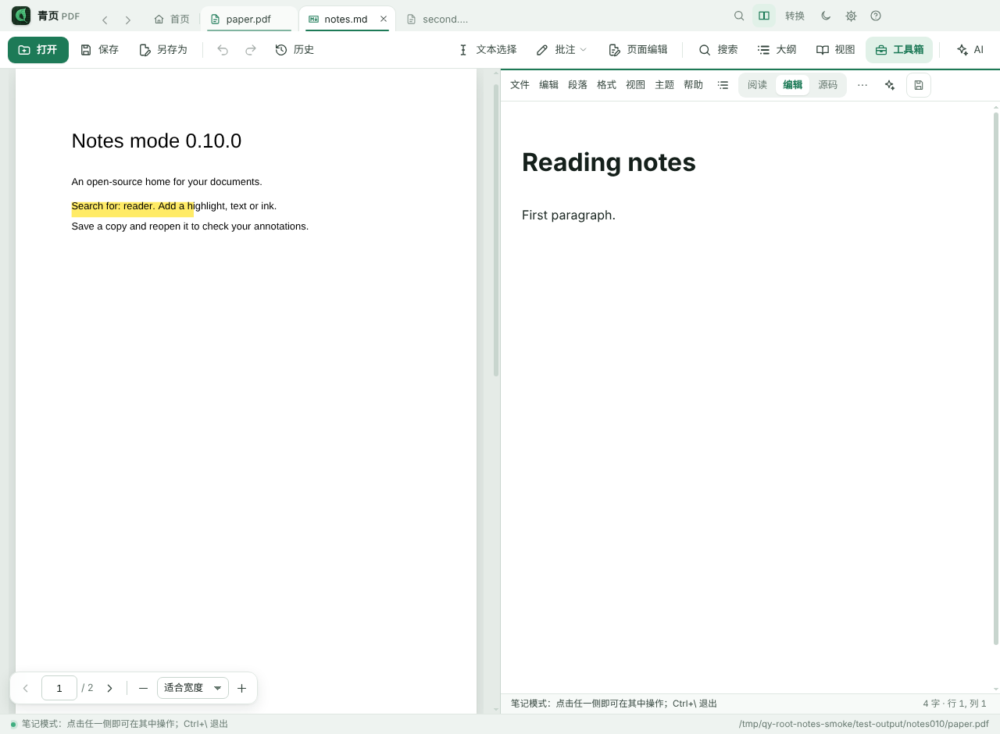

# 青页 PDF · Qingye PDF

青页 PDF 是一款本地优先的 PDF 阅读与 Markdown 笔记工具。可以在同一窗口阅读、批注和整理笔记，也可以进行 OCR、页面管理和文档转换。

当前交付目标为 **Windows 0.20.0，Windows 10 / 11 x64**。仓库中保留 macOS 与 Android 的代码和历史说明，0.20.0 未对这两个平台重新构建或验收。



## 功能

- PDF 多标签阅读、搜索、书签、批注、页面管理和文字差异比较。
- PDF 与 Markdown 并排，摘录内容可链接回原文；工作区可保存文档组合。
- Markdown 编辑、公式、图表和导出；支持 Word、Excel、PowerPoint 等 Office 文件以 PDF 打开。
- 本地 OCR、压缩、涂黑、加密和批量转换；可选连接用户配置的 AI 服务。

功能细节和已知限制见 [功能范围](docs/features/FEATURES.md)，具体操作见 [使用手册](docs/guide/USER-GUIDE.md)。

## 下载与使用

Windows 发布物为安装程序 `QingyePDF-<版本>-Setup-x64.exe` 和安装目录压缩包 `QingyePDF-<版本>-win-x64.zip`。从项目的 Releases 页面取得实际发布的文件；本地构建产物和验证状态见 [当前交接](docs/releases/HANDOFF.md)。

打开软件后可以拖入文档，或通过首页选择文件。未签名的 Windows 安装程序可能显示发布者提示；用户可核对发布时提供的 SHA-256 校验值。

## 从源码运行

Windows 开发环境需要 Node.js 22.12+、npm 11.21.1 和 Python 3.12。安装依赖、准备 PDF.js、Pandoc、LibreOffice 与后端，之后运行 `npm start`。完整命令、测试和打包方法见 [构建与发布](docs/development/BUILDING.md)。

```powershell
npm install -g npm@11.21.1
npm ci
npm start
```

未准备相应引擎时，PDF 工具、文档转换和 Office 打开可能无法使用。

## 文档与参与

[文档目录](docs/README.md)按功能、使用、开发、历史版本、缺陷和许可组织全部项目说明。[贡献指南](docs/development/CONTRIBUTING.md)介绍提交和测试流程；安全问题请按[安全策略](docs/security/SECURITY.md)私下报告。

文档处理在本机进行。AI、引用信息联网补全和手动检查更新会在用户触发时发出相应请求；转换时使用外部资源或高级参数的行为见[转换说明](docs/features/CONVERSION.md)。

本项目按 [AGPL-3.0-only](docs/legal/LICENSE) 发布；第三方组件及其许可证见[第三方声明](docs/legal/THIRD_PARTY_NOTICES.md)。
